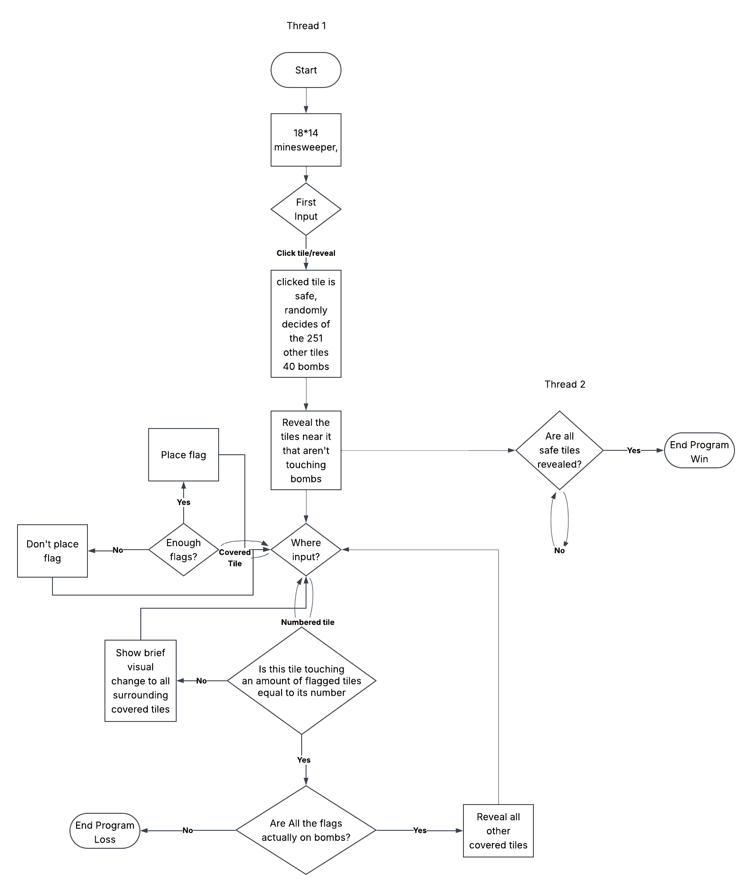

# RTK's Sweeper

Minesweeper that has attempted to optimize gameplay by reducing all functions to a single button

## The Problem

I’ve been playing minesweeper for a very long time and one of my biggest conflicts is deciding which platform I play on. On one hand the google minesweeper’s mouse keybinds provide a useful highlighting tool that allows one to play the game more efficiently. But on the other, the webpage’s version, various functions are fitted onto a singular button, the space key, that allows for an even more efficient run. The combination of these two specific functions would be very convenient to increase my PR time.

## How It Works

The first input will always guarantee a safe tile, after that 40 tiles are randomly decided as bombs. Another thread is dedicated to constantly checking the state of the board, mainly to see if the player has won. While the singular input decides what actions occur. Variance existing along if the input happened on a covered tile, or a uncovered and numbered tile.



## Tech Stack

- **Language:** Java
- **Libraries:** None(?)
- **External tools:** None(?)

## Setup
Has this actually been covered yet(?)
Step-by-step: how does someone who just cloned your repo get it
running?

```bash
git clone https://github.com/you/your-project
cd your-project
./install.sh   # or whatever
```

## Usage
Couldn't tell ya
How to actually run the thing, with examples.

```bash
./backup.sh ~/Documents
```

## Roadmap

- [ ] Custom keybinds
- [ ] Multiple Difficulties
- [ ] Leaderboards
- [ ] Continuing to play off a loss
- [ ] Tutorial
- [ ] Custom Difficulties

## Author

Kolasuba, https://github.com/kolasuba
